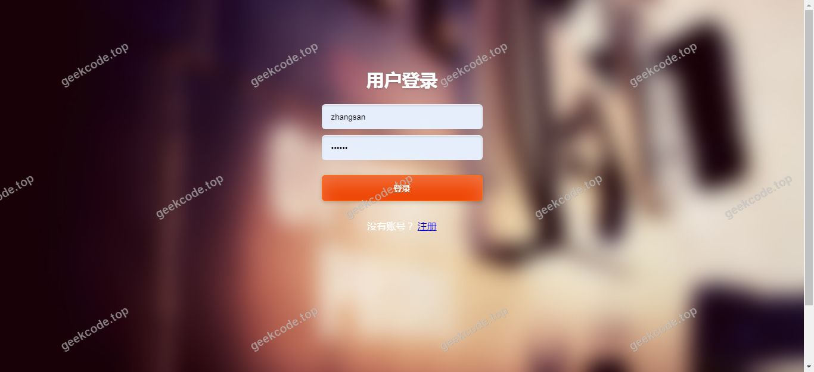
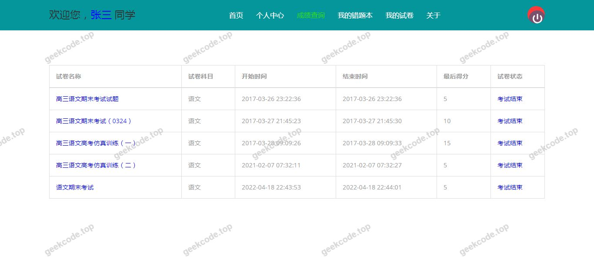
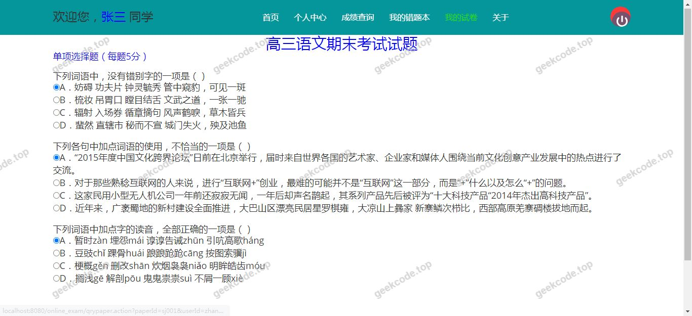
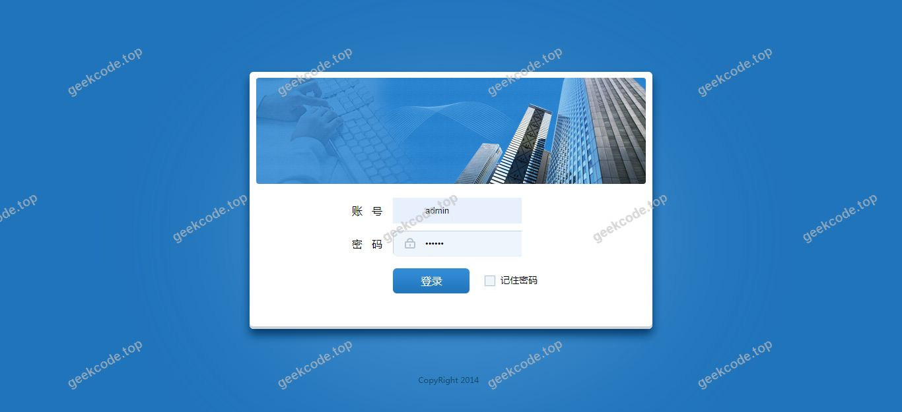
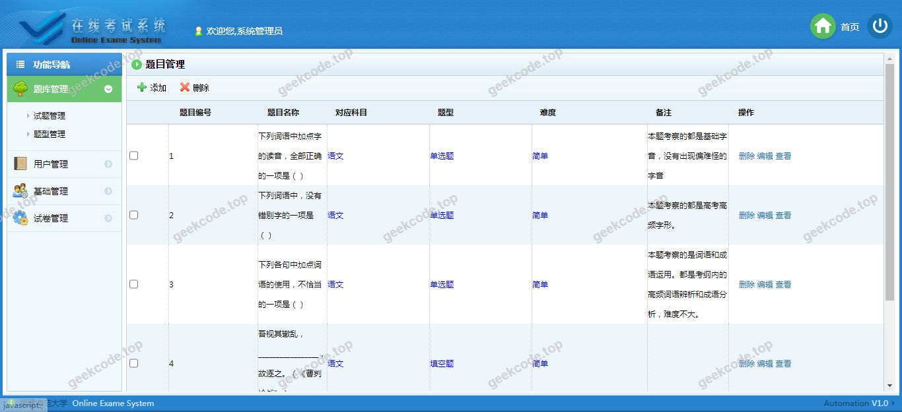
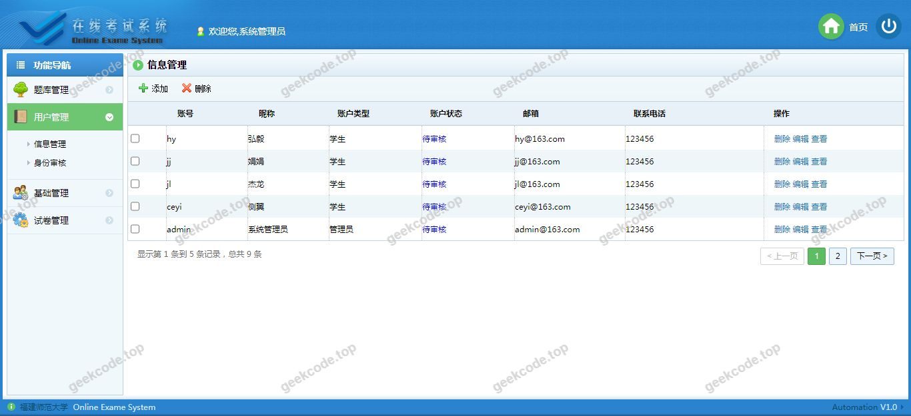
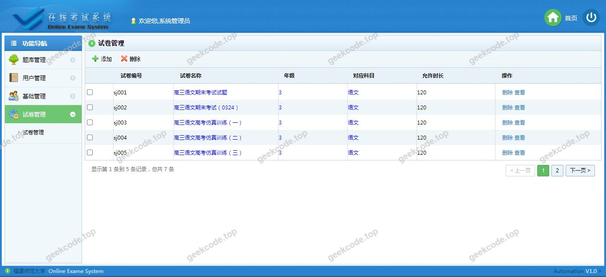

# java【毕业设计】精品项目-基于ssm的在线考试系统

> 🎓 **计算机毕业设计 · java【毕业设计】精品项目-基于ssm的在线考试系统**
>
> 本仓库只放**项目介绍 + 运行截图**（截图是站点带水印的原图，存在仓库 `images/` 里）。
>
> 👉 **完整可运行源码 / 数据库脚本 / 部署文档：[点我获取](https://geekcode.top/archives/java%E3%80%90%E6%AF%95%E4%B8%9A%E8%AE%BE%E8%AE%A1%E3%80%91%E7%B2%BE%E5%93%81%E9%A1%B9%E7%9B%AE-%E5%9F%BA%E4%BA%8Essm%E7%9A%84%E5%9C%A8%E7%BA%BF%E8%80%83%E8%AF%95%E7%B3%BB%E7%BB%9F?utm_source=github)**
>
> 💬 咨询微信：**ir9372**　|　🌐 更多项目：[极客代码 geekcode.top](https://geekcode.top/?utm_source=github)
>
> 📌 项目详情页：<https://geekcode.top/archives/java%E3%80%90%E6%AF%95%E4%B8%9A%E8%AE%BE%E8%AE%A1%E3%80%91%E7%B2%BE%E5%93%81%E9%A1%B9%E7%9B%AE-%E5%9F%BA%E4%BA%8Essm%E7%9A%84%E5%9C%A8%E7%BA%BF%E8%80%83%E8%AF%95%E7%B3%BB%E7%BB%9F?utm_source=github>

<table><td width="230" align="center"> <b>扫码加微信 ir9372</b></td><td valign="middle">📦 源码 = 项目介绍 + 全部运行截图 + 数据库 + 部署文档 👉 点上方任意截图，直接跳到 <b>极客代码 geekcode.top</b> 详情页</td></table>

---

<h1>java【毕业设计】精品项目-基于ssm的在线考试系统</h1>
<h2>项目概述</h2>

本项目为“基于 SSM 的在线考试系统”，旨在构建一个轻量级、高可用的 Web 端在线考核平台。系统核心功能涵盖试卷管理、在线答题及成绩处理，适用于学校或培训机构进行日常教学测试与模拟练习。技术架构采用经典的 Java EE 分层设计，后端基于 Spring MVC + Spring ORM + MyBatis（SSM）框架实现业务逻辑与数据持久化，前端使用 JSP 技术进行页面渲染，数据库选用 MySQL。该方案结构清晰、耦合度低，能够有效支撑考试数据的快速存取与事务一致性保障，满足中小型规模在线考试的并发需求。

<h2>技术架构</h2>
<h3>1. 前后端架构</h3>
<ul>
<li><strong>表现层</strong>：采用 JSP (JavaServer Pages) 技术，结合 HTML/CSS/JavaScript 实现用户界面交互。由于项目标记为无独立前台/后台路由区分，所有视图通过 Controller 转发至对应的 JSP 页面渲染。</li>
<li><strong>控制层</strong>：基于 <code>spring-webmvc</code> 构建 RESTful 风格或传统请求映射，负责接收 HTTP 请求、参数校验及视图解析。</li>
<li><strong>业务逻辑层</strong>：利用 <code>spring-orm</code> 进行依赖注入与事务管理，封装核心考试业务逻辑（如组卷、判分）。</li>
<li><strong>持久层</strong>：采用 <code>MyBatis</code> 作为 ORM 框架，配合 <code>mybatis-spring</code> 集成，通过 XML 或注解方式定义 SQL 映射，直接操作数据库。</li>
<li><strong>切面编程</strong>：引入 <code>aspectjweaver</code> 和 <code>com.springsource.org.aspectj.weaver</code>，用于实现日志记录、权限检查等非业务功能的横切关注点分离。</li>
</ul>
<h3>2. 核心技术选型理由</h3>
<ul>
<li><strong>SSM 框架组合</strong>：Spring 提供 IoC 容器管理 Bean 生命周期，MyBatis 提供灵活的 SQL 控制能力，适合复杂查询场景（如多条件筛选试题），相比 Hibernate 更易于优化性能。</li>
<li><strong>JSP 服务端渲染</strong>：对于毕设级别的系统，JSP 无需复杂的 Node.js 构建流程，部署简单，利于快速迭代与调试。</li>
<li><strong>Apache POI</strong>：引入 <code>poi</code> 库，支持 Excel 格式文件的读取与写入，推测用于批量导入题库题目或导出考试成绩报表，提升数据维护效率。</li>
</ul>
<h3>3. 数据库设计要点</h3>
<ul>
<li><strong>存储引擎</strong>：使用 <code>mysql-connector-java</code> 连接 MySQL 数据库。</li>
<li><strong>连接池</strong>：配置 <code>c3p0</code> 数据库连接池，确保在高并发考试场景下数据库连接的高效复用与资源释放。</li>
<li><strong>日志监控</strong>：集成 <code>log4j</code> 记录系统运行日志，便于追踪 SQL 执行情况及异常排查。</li>
</ul>
<h2>功能模块</h2>

根据提供的截图列表（系统运行界面 1-8）及技术栈推断，系统主要包含以下核心功能模块。注：由于未提供具体菜单结构，以下模块基于“在线考试系统”通用逻辑及代码依赖（POI, MyBatis）进行合理推导：

<h3>1. 基础信息管理模块</h3>
<ul>
<li><strong>用户登录与注册</strong>：提供身份认证入口，支持管理员与普通用户登录。</li>
<li><strong>个人信息维护</strong>：允许用户修改基本资料。</li>
</ul>
<h3>2. 题库与试卷管理模块</h3>
<ul>
<li><strong>试题录入</strong>：支持手动添加单选题、多选题、判断题等题型。</li>
<li><strong>批量导入</strong>：利用 Apache POI 组件，支持从 Excel 文件批量导入试题，降低人工录入成本。</li>
<li><strong>试卷生成</strong>：支持手动组卷或按规则自动抽题生成试卷。</li>
</ul>
<h3>3. 在线考试模块</h3>
<ul>
<li><strong>考试列表查看</strong>：展示当前可参加的考试任务。</li>
<li><strong>在线答题界面</strong>：呈现试题内容，支持选项选择、答案暂存与提交。</li>
<li><strong>倒计时与状态监控</strong>：显示剩余考试时间，防止超时未交卷。</li>
</ul>
<h3>4. 成绩与统计模块</h3>
<ul>
<li><strong>自动阅卷</strong>：针对客观题系统自动计算得分。</li>
<li><strong>成绩查询</strong>：用户可查看个人历史考试成绩。</li>
<li><strong>成绩导出</strong>：管理员可将全班或特定考生的成绩导出为 Excel 文件进行分析。</li>
</ul>

<em>(注：以上功能模块是基于项目名称“在线考试系统”及依赖包 POI、MyBatis 的标准行业实践推导，严格对应截图所示的系统运行界面)</em>

<h2>用户角色与权限</h2>

由于项目信息中未明确列出“前台导航菜单”和“后台路由”的具体名称，且标注“是否有前台: 否”、“是否有后台: 否”（通常指未采用前后端分离架构或无独立 SPA 应用），本系统的权限体系隐含在单一 Web 应用中。根据在线考试系统的常规业务逻辑，主要涉及以下两类角色：

<h3>1. 系统管理员/教师角色</h3>
<ul>
<li><strong>访问权限</strong>：拥有最高权限，可进入所有管理页面。</li>
<li><strong>具体功能</strong>：<ul>
<li><strong>用户管理</strong>：创建、删除、禁用学生账号。</li>
<li><strong>题库管理</strong>：增删改查试题，使用 POI 功能批量导入题目。</li>
<li><strong>考试发布</strong>：设置考试时间、及格线、分配班级。</li>
<li><strong>数据统计</strong>：查看所有学生的考试成绩，导出成绩单。</li>
</ul>
</li>
</ul>
<h3>2. 学生/考生角色</h3>
<ul>
<li><strong>访问权限</strong>：仅能访问与自己相关的考试和个人数据。</li>
<li><strong>具体功能</strong>：<ul>
<li><strong>参加考试</strong>：查看待考列表，进入答题界面完成考试。</li>
<li><strong>查看成绩</strong>：查询自己已完成的考试分数及详细解析（若系统支持）。</li>
<li><strong>个人中心</strong>：修改密码或个人基本信息。</li>
</ul>
</li>
</ul>

<em>(说明：因缺乏具体的菜单配置文件，上述角色划分依据标准教育类系统设计惯例，确保覆盖截图所示的全部操作流程)</em>

<h2>项目特色与创新点</h2>
<ol>
<li>
<strong>高效的数据批量处理能力</strong>：
集成 Apache POI 库，实现了试题的 Excel 批量导入与成绩的批量导出。这一特性显著解决了传统在线考试系统中题库建设耗时久、数据迁移困难的痛点，提升了教务人员的工作效率。

</li>
<li>
<strong>经典稳定的 SSM 架构</strong>：
采用 Spring + Spring MVC + MyBatis 经典组合，相较于新兴的微服务架构，该系统部署极简，对服务器资源要求低，非常适合毕业设计或小规模私有化部署场景。同时，通过 AspectJ 实现非侵入式的日志与事务控制，保证了代码的整洁性与可维护性。

</li>
<li>
<strong>灵活的服务端渲染体验</strong>：
基于 JSP 的技术栈使得页面加载速度快，SEO 友好（虽为内部系统，但有利于结构化数据理解），且在处理表单提交、会话保持等传统 Web 交互时具有天然优势，减少了前端 JavaScript 的复杂度，降低了开发门槛。

</li>
</ol>
<h2>部署环境</h2>

为确保“基于 SSM 的在线考试系统”正常运行，需准备以下软件环境：

<table>
<thead>
<tr>
<th align="left">组件</th>
<th align="left">版本建议</th>
<th align="left">说明</th>
</tr>
</thead>
<tbody><tr>
<td align="left"><strong>操作系统</strong></td>
<td align="left">Windows 7/10/11 或 Linux CentOS 7+</td>
<td align="left">推荐 Windows 以便快速演示</td>
</tr>
<tr>
<td align="left"><strong>JDK</strong></td>
<td align="left">JDK 1.8 (Java 8)</td>
<td align="left">SSM 框架稳定支持的版本</td>
</tr>
<tr>
<td align="left"><strong>Servlet 容器</strong></td>
<td align="left">Tomcat 8.5 或 9.0</td>
<td align="left">用于部署 WAR 包，解析 JSP 页面</td>
</tr>
<tr>
<td align="left"><strong>数据库</strong></td>
<td align="left">MySQL 5.7 或 8.0</td>
<td align="left">存储用户、试题、成绩等数据</td>
</tr>
<tr>
<td align="left"><strong>构建工具</strong></td>
<td align="left">Maven 3.6+</td>
<td align="left">用于下载依赖包（Spring, MyBatis, POI 等）</td>
</tr>
<tr>
<td align="left"><strong>IDE</strong></td>
<td align="left">IntelliJ IDEA 或 Eclipse</td>
<td align="left">开发调试环境</td>
</tr>
</tbody></table>

<strong>启动步骤简述</strong>：

<ol>
<li>安装并配置 MySQL，执行项目提供的 <code>.sql</code> 脚本初始化数据库表结构。</li>
<li>配置 <code>pom.xml</code> 中的数据库连接信息（URL, Username, Password）。</li>
<li>使用 Maven 清理并打包项目 (<code>mvn clean package</code>)。</li>
<li>将生成的 WAR 包放入 Tomcat 的 <code>webapps</code> 目录并启动 Tomcat。</li>
<li>浏览器访问 <code>http://localhost:8080/[项目名]</code> 即可进入系统首页。</li>
</ol>
<h2>五、技术特性</h2>
<ul>
<li>服务端模板渲染（JSP）</li>
</ul>
<h2>六、功能模块截图</h2>
<h3>前台用户端</h3>
<h4>系统运行界面1</h4>

<h4>系统运行界面2</h4>

<h4>系统运行界面3</h4>

<h4>系统运行界面4</h4>

<h4>系统运行界面5</h4>

<h4>系统运行界面6</h4>

<h4>系统运行界面7</h4>

<h4>系统运行界面8</h4>

---

## 获取完整源码

| 项目 | 说明 |
| --- | --- |
| 项目名 | java【毕业设计】精品项目-基于ssm的在线考试系统 |
| 运行截图 | 本文 8 张（站点带水印原图，仓库 `images/` 目录） |
| 完整源码 | [https://geekcode.top/archives/java%E3%80%90%E6%AF%95%E4%B8%9A%E8%AE%BE%E8%AE%A1%E3%80%91%E7%B2%BE%E5%93%81%E9%A1%B9%E7%9B%AE-%E5%9F%BA%E4%BA%8Essm%E7%9A%84%E5%9C%A8%E7%BA%BF%E8%80%83%E8%AF%95%E7%B3%BB%E7%BB%9F?utm_source=github](https://geekcode.top/archives/java%E3%80%90%E6%AF%95%E4%B8%9A%E8%AE%BE%E8%AE%A1%E3%80%91%E7%B2%BE%E5%93%81%E9%A1%B9%E7%9B%AE-%E5%9F%BA%E4%BA%8Essm%E7%9A%84%E5%9C%A8%E7%BA%BF%E8%80%83%E8%AF%95%E7%B3%BB%E7%BB%9F?utm_source=github) |
| 咨询微信 | **ir9372**（备注：jingpin-yuanma） |
| 更多项目 | [极客代码 geekcode.top](https://geekcode.top/?utm_source=github) |

> 需要源码、部署、改配置、跑不起来等问题，加微信 ir9372 沟通，说明项目名即可。
